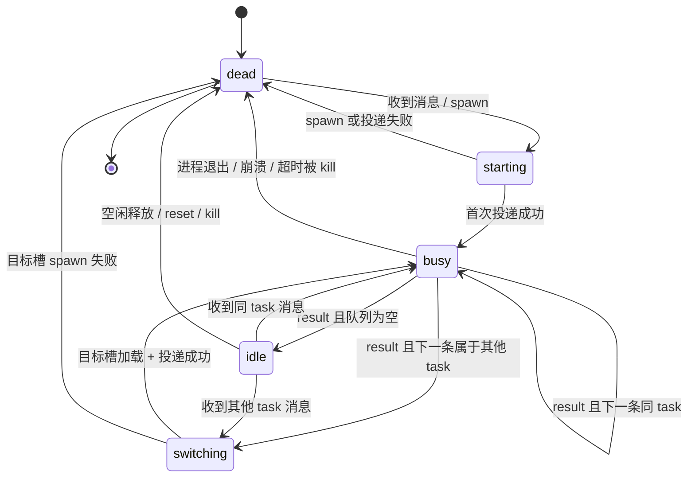
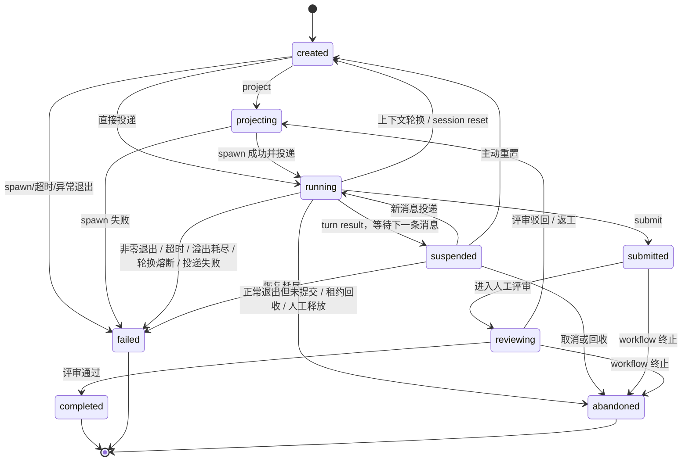
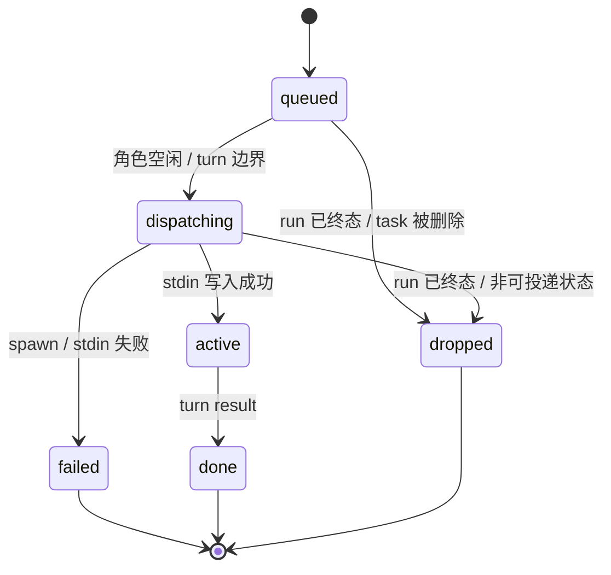

# 角色状态机全量设计

- 日期：2026-11-10
- 状态：规范（实现以本文 + 代码测试为准）
- 范围：角色常驻运行时、run 生命周期、任务上下文槽、角色队列、task/workflow 的映射、运行时 API 与前端状态展示
- 取代关系：本文修正 `design.md` §6.1/§6.2 的旧口径（“8 态 run”“600s 直接 failed”“等待时保持 running”）；旧描述仅作历史参考

## 1. 为什么需要单独的角色状态规范

Anvil 里“角色状态”不是单一字段，而是六个相互关联的层：

1. 角色常驻进程（`role_sessions.status`）
2. 每个 `(role, task)` 的上下文槽（`role_task_sessions.status`）
3. run（`runs.status`）
4. 角色队列项（daemon 内存 `_Queued`）
5. task（`tasks.status`）
6. workflow step（`workflow_steps.status`）

历史实现把“run 已经失败/结束”和“角色进程仍忙”混在一起，导致：
- 进程退出时把排队 run 一并判失败；
- 队列随后又把已失败 run 投递出去；
- UI 出现“run 失败但角色显示进行中”；
- 重置/溢出只清当前任务槽，却把其它任务队列一起丢掉。

本规范先定义每层的状态与不变量，再定义层间迁移。实现和测试必须按此对照。

## 2. 状态层与字段

### 2.1 角色进程

| 状态 | 存储 | 语义 |
|---|---|---|
| `starting` | `role_sessions.status` | 进程已 spawn，尚未完成首次投递；必须有超时 |
| `idle` | 同上 | 进程存活，当前槽已加载，没有执行中的 turn |
| `busy` | 同上 | 正在执行一个 turn；`current_run_id/current_task_id/current_step_id` 必须非空且一致 |
| `dead` | 同上 | 无存活进程；上下文槽仍持久化 |

`switching` 不是持久角色状态：它是 `busy → busy` 换任务上下文时内存中的过渡标志（`_Role.switching`），用于让 scheduler/UI 在杀旧进程→拉新进程窗口内不把角色判死。它必须有超时，不得长期为真。

### 2.2 任务上下文槽

`role_task_sessions` 每个 `(role_slug, task_key)` 一行；`task_key` 是 task id 或 `__global__`。

| 状态 | 语义 |
|---|---|
| `idle` | 槽可用，session 可恢复 |
| `busy` | 当前加载并正在使用 |
| `dead` | session/cwd 不可恢复；下次进入新建 CIC |

`role_task_sessions.session_id`/`cwd`/`workspace_path`/`context_tokens`/`last_seen_activity_id` 决定 `--resume` 还是新建 CIC。cwd 不一致时不得 resume。

### 2.3 Run（9 态）

| 状态 | 终态 | 语义 |
|---|---|---|
| `created` | 否 | 已建 run，尚未投影/投递 |
| `projecting` | 否 | 正在投影/准备 spawn |
| `running` | 否 | 已派发/活跃；**只有 daemon `current_run_id` 等于它时才真正执行**，排队中也可能是 running |
| `suspended` | 否 | 等待下一条消息的正常活跃态；不是失败，不写 `ended_at/failure_class` |
| `submitted` | 否 | 已提交，等待评审接管 |
| `reviewing` | 否 | HITL 人工评审中；不得被 mention 自动拉回执行 |
| `completed` | 是 | 成功终态 |
| `failed` | 是 | 技术性失败（超时/崩溃/溢出耗尽/轮换熔断/投递失败） |
| `abandoned` | 是 | 未提交退出、租约回收、人工终止、workflow 终止 |

终态集合：`completed/failed/abandoned`。可投递集合：`created/projecting/running/suspended`。`submitted/reviewing` 是控制面 HITL 态，不能出现在可投递队列中。

### 2.4 队列项

队列是每角色 FIFO，元素：`(text, run_id, task_id, spawn_spec)`。

| 状态 | 语义 |
|---|---|
| `queued` | 已入队，尚未投递 |
| `dispatching` | 正在切换上下文/写 stdin |
| `active` | 已写入，正在执行 turn |
| `done` | 该 turn 已结束 |
| `dropped` | run 已终态/不可投递/task 删除；写 audit |
| `failed` | spawn/stdin 失败；对应 run 标 failed，继续下一条 |

队列项不是 run：一个 run 在任意时刻最多一个 active 队列项；不得把同一 run 重复投递。

### 2.5 Task / workflow step

Task 五态：`todo / in_progress / in_review / done / closed`。`closed` 是人工终止，不等于 `done`。

Workflow step：`pending / running / submitted / approved / rejected / failed / skipped`。自动恢复中的步骤是 `pending` + `recovery_count/next_retry_at`，不是普通待办；`skipped` 只在 workflow 终止时出现，**不能当作 normal done**。

### 2.6 角色镜像字段

`role_sessions.current_task_id/current_run_id/current_step_id` 是角色当前执行绑定的镜像，不是历史字段。

- `busy`：三者必须非空，且 `current_run.task_id == current_task_id`。
- `idle/dead`：三者必须为空；`busy_since` 必须为空。
- `context_task_id` 只表示当前加载的槽，不代表忙；空闲但保留上下文时它仍可有值。

## 3. 状态迁移图

### 3.1 角色进程



### 3.2 Run



### 3.3 队列项



## 4. 迁移表

### 4.1 角色进程

| 当前 | 事件 | Guard | 目标 | 副作用 |
|---|---|---|---|---|
| dead | 收到消息 | 槽可加载 | starting | spawn；DB starting |
| starting | 首次 stdin 写入成功 | run 可投递 | busy | `_send_locked` 设置 current；DB busy；run running |
| starting | spawn/stdin 失败 | — | dead | run failed(delivery_error/spawn_error)；清 current；audit |
| busy | result 且队列为空 | 当前 proc 匹配 | idle | run suspended/completed；槽 idle；current 清空 |
| busy | result 且下一条同 task | 当前 proc 匹配 | busy | 不杀进程，继续投递 |
| busy | result 且下一条其他 task | 当前 proc 匹配 | switching→busy | 保存槽 → kill → 加载目标槽 → spawn → 投递 |
| busy | 进程退出 | 当前 proc 匹配 | dead | 只把 `exit_run_id` 交给 process_exit；清 current；队列交给 recovery |
| idle | 收到本 task 消息 | 进程存活 | busy | 直接投递 |
| idle | 收到其他 task 消息 | 进程存活 | switching→busy | 换槽 |
| idle | 空闲超时/手动 kill/reset | — | dead | 保存槽；不触发 on_exit |
| switching | 目标 spawn+投递成功 | — | busy | 新 current |
| switching | 目标 spawn 失败 | — | dead | 队列项 failed/丢弃；run failed |

### 4.2 Run

| 当前 | 事件 | Guard | 目标 | 副作用 |
|---|---|---|---|---|
| created | project/wake | — | projecting | activity |
| projecting | spawn 成功 | — | running | `mark_spawned`；启动超时 |
| created/projecting/suspended | 实际投递 | 仍在可投递集合 | running | 写 started_at；ledger；设置角色 current |
| running | turn result | `status=running` CAS | suspended | 清 ended_at；不写 failure_class |
| running | reminder turn result | CAS running | completed | 清 ended_at |
| running | submit | — | submitted | HITL 等待 |
| submitted | await_review | — | reviewing | @human |
| reviewing | human approve | — | completed | 清角色 current |
| reviewing | human reject | — | projecting | 清 native_session |
| running/suspended | 上下文轮换/主动重置 | run 非终态 | created | 刷新 started_at；清 native_session |
| running | 非零退出/超时/溢出耗尽/轮换熔断/投递失败 | — | failed | failure_class；清角色 current |
| running | 正常退出未提交/租约回收 | — | abandoned | ended_at |
| suspended | 恢复耗尽/取消 | — | failed/abandoned | 清角色 current |
| submitted/reviewing | workflow terminate | — | abandoned | 步骤 failed/terminated |
| completed/failed/abandoned | 任意写入 | — | 不变 | 终态不可复活；人工 reopen 走显式 API |

### 4.3 队列/终态清理

| 事件 | 队列项处置 | 角色 current 处置 |
|---|---|---|
| 队列项 run 已终态 | dropped + audit | 不设置 busy |
| 队列项 run 变为 submitted/reviewing | dropped + audit | 不设置 busy |
| stdin/spawn 失败 | failed；run failed(delivery_error) | 清 busy/current；继续下一条 |
| 进程退出 | 排队项保留 | 只清退出的 current；由 recovery 续投 |
| task 删除 | 删除该 task 的队列项 | 若正忙该 task，杀进程并清 current |
| task 级 reset/restart | 只删目标 task 的队列项 | 只清目标 task 的槽/current |
| 角色级 reset | 清全部队列 | 清全部 current |
| 终态 run 仍是 current | — | clear_run / scheduler 对账清 current |

## 5. 核心不变量

1. 一个角色最多一个常驻进程、一个执行中的 turn。
2. `busy` ⇔ 有且仅有一个 `current_run_id`；`current_run.task_id == current_task_id`。
3. 终态 run（completed/failed/abandoned）不得再保持角色 `busy/current_*`。
4. 进程 `dead` 时内存和 DB 的 `current_*`、`busy_since` 必须为空。
5. 终态 run 不得出现在可投递队列中；队列项不得在 run 终态后执行。
6. 进程退出只影响它实际拥有的当前 run；排队 run 保持原状态等待队列恢复。
7. `reset/restart` 必须保持作用域：run/task reset 不清其他 task 的队列和槽。
8. `context_overflow` 标志归属于“当前进程”；新进程启动必须清空旧标志，旧 reader 不得消费新进程的标记。
9. 阈值轮换必须有连续次数上限；超过后转技术性失败，交自动恢复，不无限 CIC 循环。
10. 每次 run 状态迁移必须写 ledger/activity；终态迁移必须触发角色状态对账。
11. 等待 human/peer 用 `suspended` 表示，不是 `running`，不是 failed；HITL 不自动重试。
12. UI 状态必须以“已终止 > 已完成 > 失败 > 等待重试 > 实时忙碌 > 排队 > 待办”的顺序解析；徽标颜色独立于点灯颜色。

## 6. 等待语义

| 场景 | run 状态 | 角色进程 | 处理 |
|---|---|---|---|
| 等其它角色回复 | `suspended` | idle/dead | 对方有活跃 run/忙则跳过；空闲/失联超过 nudge 阈值才 resume |
| 等 human | `suspended` | idle/dead | 不自动重试；human @ 回来时 mention 唤醒 |
| 等模型/工具 | `running` | busy | 只做 liveness；超过 run timeout 重置会话并自动恢复 |
| 忙 A，B 消息排队 | B 可仍为 `running`（已派发未执行） | busy A | B 不占 `current_run_id`；A turn 结束/退出后 FIFO 处理 |
| B 的 workflow step 等待 | step `pending` | — | 不创建 B 的 run；角色空闲后 advance |
| 进程已死但 run 仍 running | 宽限期后 `suspended` | dead | 清 current；下次用新 CIC；不 @human |

## 7. 失败、超时与恢复

### 7.1 failure_class

至少保证：
- `platform_timeout`：run 级超时
- `agent_exit_<code>`：agent 非零退出
- `spawn_error`：无法拉起进程
- `delivery_error`：stdin 写入失败
- `context_overflow`：溢出重试耗尽
- `context_rotation_loop`：连续上下文轮换熔断
- `orphaned_step_run`：步骤重排后的孤儿 run
- `step_stalled`：步骤 nudge 耗尽

HITL 点（评审、gate、审批、决策僵局）不自动重试。

### 7.2 超时优先级

1. 运行时 YAML 冻结的 `timeout_seconds`（默认 3600s）
2. `ANVIL_RUN_TIMEOUT` 兜底（未冻结时）
3. `ANVIL_RUN_DEAD_GRACE_SECONDS`（默认 60s）：死进程宽限
4. `ANVIL_RUN_PHASE_STALL_SECONDS`（默认 60s）：projecting 卡住重投
5. 租约（30min/2min heartbeat/3 次）只负责失联回收，不是执行超时

### 7.3 自动恢复

技术性失败 → 步骤回 `pending`，指数退避（默认 2min 起、30min 上限、10 次）；重跑提示带失败原因；耗尽后步骤失败并写非阻塞 comment，不 @human。

### 7.4 上下文轮换

- 主动水位轮换（turn-end 高水位）是正常管理，不计入 overflow 失败预算；
- 但连续轮换必须计数（`runs.context_rotation_count`），超过 `CONTEXT_ROTATION_MAX_CONSECUTIVE`（默认 5）以 `context_rotation_loop` 失败，交步骤自动恢复；
- 硬阈值/API 溢出/请求体溢出：终止当前进程，CIC 新会话重投；payload/API 溢出受 `CONTEXT_RESET_MAX_RETRIES` 限制；
- 换会话前写知识快照；只清当前 task 槽。

## 8. 重置与队列

| 操作 | 作用域 | 队列 | 槽 | 进程 |
|---|---|---|---|---|
| `restart` | run/角色 | 保留其他消息；当前 run 重排队 | 全部保留 | 杀当前进程，下次按槽 resume |
| run `session-reset` | 当前 run 的 task | 只删该 task | 只清该 task | 若正忙该 task 才杀 |
| role `session-reset` | 全部 | 清全部 | 全部清 | 杀当前 |
| `full reset` | 全部 | 清全部 | 全部清 | 杀当前 |
| 角色自主 `reset-context` | 当前 task | 由 daemon 校验队列 | 只清当前 task | 终止当前轮，CIC 重投 |
| task 删除 | 该 task | 删该 task | 删该 task | 正忙该 task 才杀 |

## 9. 运行时 API

`GET /api/v1/roles/{slug}/runtime` 至少返回：

```json
{
  "role_slug": "qa-role",
  "alive": true,
  "status": "busy",
  "busy_scope": "task",
  "busy_since": "...",
  "current_task_id": "...",
  "current_task": {"id": "...", "title": "...", "status": "in_progress"},
  "current_run_id": "...",
  "current_run_status": "running",
  "current_run_failure_class": null,
  "current_step_id": "...",
  "context_task_id": "...",
  "queue_len": 2,
  "queue_global_count": 0,
  "queue_tasks": [
    {"id": "...", "title": "...", "status": "in_progress", "count": 2, "ahead_count": 0}
  ],
  "contexts": [
    {"task_id": "...", "has_session": true, "context_tokens": 1234,
     "last_active_at": "...", "status": "idle"}
  ],
  "switching": false,
  "context_tokens": 1234,
  "model_id": "..."
}
```

`queue_len` 是角色全局 FIFO 长度（不含正在执行的 turn）；`queue_tasks[].ahead_count` 是该 task 第一条消息之前还有多少条队列项（0 表示下一条就是它）；`queue_global_count` 是 `task_id=null` 的系统/提醒消息数。UI **不得**用 `max(queue_len, queuedHere)` 猜排队。

## 10. UI 状态映射

### 10.1 两层模型

- **Badge**：任务作用域，表达“这个角色在这张任务上处于什么状态”。
- **Dot**：运行时作用域，表达“角色进程现在在做什么”。

两者独立着色，禁止用 dot 颜色反推 badge 颜色。

### 10.2 Badge 优先级

`closed → done → failed → retry_wait → abandoned → switching → working_here → working_elsewhere → working_global → queued_ahead（仅 alive）→ waking（!alive）→ submitted → idle_context → released → todo → unknown`

| 状态 | 标签 | 徽标色 | 点灯 |
|---|---|---|---|
| closed | 已终止 | 灰 | 灰 |
| done | 完成 | 绿 | 蓝/灰（空闲时） |
| failed | 失败 | 红 | 红 |
| retry_wait | 等待重试 | 琥珀 | 琥珀 |
| abandoned | 已放弃/已中断 | 灰 | 灰 |
| switching | 切换上下文 | 琥珀 | 琥珀 |
| working_here | 进行中 | 蓝 | 绿 |
| working_elsewhere | 繁忙 | 红 | 红 |
| working_global | 进行中（系统任务） | 蓝/红 | 红 |
| queued_ahead | 排队中 | 琥珀 | 琥珀 |
| waking | 等待唤醒 | 琥珀 | 琥珀 |
| submitted | 待确认 | 黄 | 黄 |
| idle_context | 空闲 · 上下文保留 | 蓝 | 蓝 |
| released | 已释放 | 灰 | 灰 |
| todo | 待办 | 灰 | 灰 |
| unknown | 未知/加载中 | 灰 | 灰 |

说明：
- `done` 高于 `failed`：任务已完成后，历史失败 run 不得把角色 chip 变红；run 历史只在 run 详情/时间线展示。
- `closed` 永远不等于 `done`；workflow `terminated` 走 `closed`。
- `queued_ahead` 只在进程 alive 时使用；进程已死时即使前面有别的 task 也显示“等待唤醒”。
- `abandoned` 不等于失败；只有没有待重试步骤时才显示“已放弃/已中断”。

### 10.3 Run/step 标签统一

Run：`created 已创建 / projecting 准备中 / running 运行中 / suspended 等待唤醒 / submitted 已提交 / reviewing 评审中 / completed 已完成 / failed 失败 / abandoned 已放弃`。

Step：`pending 待办 / running 进行中 / submitted 待确认 / approved 完成 / rejected 返工 / failed 失败 / skipped 跳过（仅终止）/ retrying 等待重试`。

`suspended` 统一显示“等待唤醒”，不再混用“已挂起/挂起”。

## 11. 对账与可观测性

1. **正常路径**：daemon `clear_run`、`process_exit_node`、`review_node` 在终态迁移后同步清角色 current。
2. **兜底路径**：scheduler `clear_terminal_role_runs` 每 tick 对账；即使 daemon 未加载该角色，也清 DB 中仍指向终态 run 的 current。
3. **DB 不变量**：`_db_upsert`/`_slot_upsert_conn` 在 status=`idle/dead` 时强制写 `current_*=NULL`；`_heal_db` 启动时清 current。
4. **日志**：`anvil.daemon` 记录进程退出、队列丢弃/失败、上下文轮换、spawn/stdin 失败；daemon 角色日志保留 `clearing terminal run`、`process exit left N queued`、`context switch` 等。
5. **审计**：`queue.dropped`、`queue.delivery_failed`、`session.context_rotation`、`session.context_rotation_failed`、`session.context_overflow`。

## 12. 已知边界（不在本次规范强制迁移）

- run 没有独立的 `queued` 状态；排队中的 run 仍是 `running`，用 daemon `current_run_id` 区分“真正执行”。彻底引入 `queued` 态属于后续迁移。
- 角色队列是 daemon 内存队列，能承受“角色进程崩溃”，但不承受“Anvil 服务重启”；服务重启后由 `reconcile/reaper` 把活跃 run 转 suspended，已排队的 reply run 可丢失，需要重新 @。
- `set_status` 尚未做全局 allowed-transition 硬校验；当前用关键路径 CAS + scheduler 对账保证一致性。
- Lobby 任务卡不读取 workflow/run 明细时，失败/终止状态可能降级为任务卡自身状态；完整状态以任务详情「角色运行时」为准。
- `starting` 目前没有独立超时；由 scheduler 的 run 级/项目阶段看门狗兜底。

## 13. 测试对照

| 不变量/场景 | 测试 |
|---|---|
| 进程退出只失败当前 run，排队 run 不被连带 | `test_daemon.py::test_exit_callback_carries_only_current_run` |
| 终态 run 不再投递 | `test_daemon.py::test_terminal_queued_run_is_not_delivered` |
| task reset 保留其他 task 队列 | `test_daemon.py::test_task_reset_preserves_other_task_queue` |
| 进程退出清 current（内存+DB） | `test_daemon.py::test_reader_exit_clears_current_fields_and_db` |
| CAS 阻止 failed→suspended | `test_runs_lifecycle.py::test_set_status_cas_rejects_terminal_revival` |
| redelivery 刷新 started_at | `test_runs_lifecycle.py::test_reset_for_redelivery_updates_started_at` |
| 连续轮换熔断 | `test_runs_lifecycle.py::test_threshold_rotation_breaker_fails_after_limit` |
| 同角色一个进程/队列 FIFO | `test_daemon.py` 既有 A/B 切换/排队用例 |
| 等待 human/peer/model 不误伤 | `test_waiting_states.py` |
| 进程退出守卫 | `graph/test_run_graph.py` 既有 process_exit 用例 |
| UI 标签/优先级 | 前端构建 + 手动/浏览器验收：失败、终止、排队 ahead、busy global |

## 14. 2026-11-10 扩展：切片上下文

上下文槽的状态机从 `(role, task)` 细化为 `(role, task, slice)`：

- 角色当前 context 由 `role_sessions.current_context_key/current_slice_key` 表达；
- `suspended` / `running` 的判据仍以 `runs` 为准，但同一 task 可同时存在多个
  slice 的 suspended run，排队/切换按完整 context key 进行；
- slice 级 reset 只清目标槽；task 级 reset/delete 清该 task 全部 slice；
- 队列元素携带 `slice_key`，优先级 `return=10 / step=20 / findings=40 /
  mention=50 / default=100`，同优先级 FIFO；
- 派遣任务完成后的自动回切只 resume 原 suspended run，且仅一次；
  跨切片临时处理的回切用 `runs.context_return_*`，与 `task_dispatches` 分开。

详细设计见 `docs/superpowers/specs/2026-11-10-slice-context-dispatch-design.md`。
